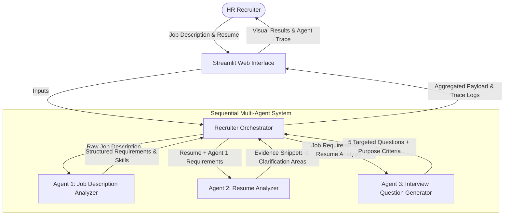

<<<<<<< HEAD
# AI Recruiter Assistant Using a Multi-Agent System

An academic, production-grade Multi-Agent System designed for On-the-Job Training (OJT) and Coursera academic submissions. It coordinates three specialized AI agents to analyze job descriptions, verify resume evidence, highlight requirements needing clarification, and generate five targeted interview questions.

---

## 🌟 Key Features

- **Three Specialized Autonomous Agents:**
  - **Agent 1: Job Description Analyzer** — Extracts standardized job titles, core technical skills, and key responsibilities.
  - **Agent 2: Resume Analyzer** — Maps skills against candidate statements, extracts verbatim evidence snippets, and identifies areas for recruiter clarification without assuming absence implies incompetence.
  - **Agent 3: Interview Question Generator** — Synthesizes gaps and verified strengths to produce 5 targeted interview questions with clear evaluation criteria.
- **Dedicated Orchestrator:** Manages state passing, logs execution trace, monitors per-agent execution time, and provides resilient error handling.
- **Dual Execution Modes:**
  - **LLM-Powered Mode:** Integrates with Groq, OpenAI, or Google Gemini via direct, zero-dependency HTTP requests.
  - **Deterministic Fallback Engine:** 100% offline, zero-config rule-based NLP engine ensuring the app is always runnable and demonstrable without paid API credits.
- **Ethical & Responsible-Use Safeguards:** Strictly advisory; no automatic candidate acceptance/rejection; zero assessment of demographic characteristics; zero permanent data storage.
- **Automated Verification:** Comprehensive `pytest` suite testing all individual agents and the orchestrator workflow.

---

## 🏗️ Multi-Agent Architecture & Workflow



---

## 📁 Project Structure

```
ai_recruiter_assistant/
├── app.py                     # Streamlit interactive web application
├── orchestrator.py            # Workflow pipeline and agent trace coordinator
├── llm_client.py              # Lightweight HTTP-based LLM caller with auto-fallback
├── agents/                    # Distinct agent implementations
│   ├── __init__.py
│   ├── job_analyzer.py        # Agent 1: Job requirements extractor
│   ├── resume_analyzer.py     # Agent 2: Evidence snippet and clarification analyzer
│   └── interview_generator.py # Agent 3: Targeted 5-question synthesis generator
├── sample_data/               # Synthetic demonstration dataset
│   ├── job_description.txt    # Realistic backend AI engineer JD
│   └── resume.txt             # Synthetic candidate resume (Alex Morgan)
├── tests/                     # Automated unit and integration test suite
│   ├── __init__.py
│   └── test_agents.py         # Pytest coverage for all agents and orchestrator
├── docs/                      # Academic documentation & visual artifacts
│   ├── PROJECT_REPORT.md      # Full academic project report (Markdown)
│   ├── PROJECT_REPORT.docx    # Professional Word document for submission
│   └── screenshots/           # Genuine execution screenshots
├── requirements.txt           # Minimal dependencies
├── .env.example               # Template for optional LLM credentials
├── .gitignore                 # Excludes cache, venvs, and sensitive keys
└── README.md                  # Project manual and verification guide
```

---

## 🚀 Quick Start Guide

### 1. Prerequisites
- Python 3.10, 3.11, 3.12, or 3.13 installed.
- Git (optional).

### 2. Install Dependencies
```bash
pip install -r requirements.txt
```

### 3. Optional: Configure LLM API Keys
The application functions immediately out-of-the-box using the deterministic rule-based engine. If you wish to enable live LLM reasoning:
1. Copy `.env.example` to `.env`:
   ```bash
   cp .env.example .env
   ```
2. Populate your preferred key (e.g., `GROQ_API_KEY`, `OPENAI_API_KEY`, or `GEMINI_API_KEY`).

### 4. Run Automated Tests
Execute the verification suite to validate all agents and the orchestrator:
```bash
pytest tests/ -v
```
*Expected result:* 8 passed in ~0.5s.

### 5. Launch the Streamlit Web Application
```bash
streamlit run app.py
```
Open your browser at `http://localhost:8501`.

---

## 🧪 Demonstration Steps

1. In the sidebar, click **"Load Sample Inputs"** to populate the synthetic Job Description and Resume.
2. Click the primary button **"🚀 Analyze Resume"**.
3. View the **Agent Execution Trace** showing execution order, latency, and status for Agent 1, Agent 2, and Agent 3.
4. Review the three structured output sections:
   - **Section 1:** Extracted role, required skills, and key responsibilities.
   - **Section 2:** Confirmed skills with direct quote evidence and flagged clarification areas.
   - **Section 3:** Five contextual interview questions with stated evaluation purposes.

---

## 🛡️ Responsible-Use & Ethical Safeguards

1. **Advisory Tool Only:** The system explicitly states that all outputs require human recruiter oversight.
2. **No Automated Decisions:** The system does not make hiring, rejection, or scoring decisions.
3. **Protected Characteristics:** Demographic factors (race, gender, age, religion, marital status) are excluded from analysis.
4. **Data Privacy:** Resumes and job descriptions are held strictly in transient memory during execution and never stored to disk or database.

---

## 🔗 Project Submission Placeholders
- **Live Demo Video (Google Drive):** `[INSERT_GOOGLE_DRIVE_VIDEO_LINK_HERE]`
- **GitHub Repository:** `[INSERT_GITHUB_REPO_URL_HERE]`
- **Live Deployment URL (Streamlit Cloud):** `[INSERT_STREAMLIT_APP_URL_HERE]`
=======
# multi-agent
>>>>>>> 92450bd8ac3874b2808d64e51497ae0f89d836ee
