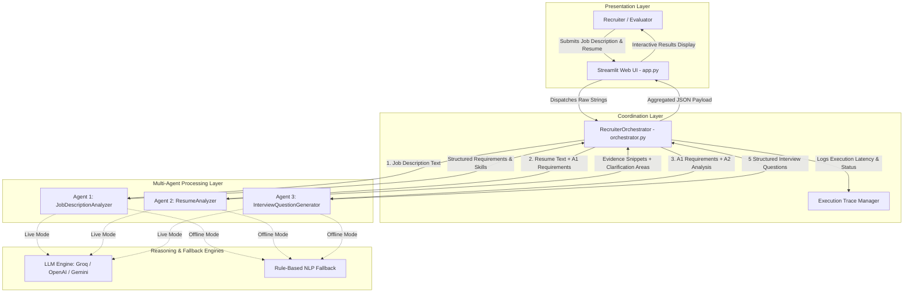
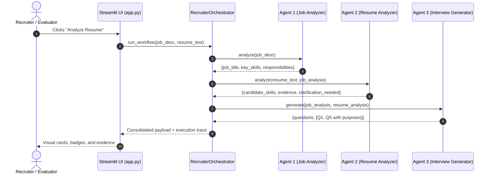

# Academic Project Report
## AI Recruiter Assistant Using a Multi-Agent System

---

### A. Cover Page

```
========================================================================================
                          ACADEMIC PROJECT REPORT ON
             "AI RECRUITER ASSISTANT USING A MULTI-AGENT SYSTEM"

          Submitted in partial fulfillment of the requirements for the award of
                      On-the-Job Training (OJT) / Academic Coursework
========================================================================================

STUDENT DETAILS:
----------------------------------------------------------------------------------------
Student Full Name : [Student Name - e.g., Omkar Sharma]
SAP ID            : [SAP ID - e.g., 500098765]
Roll Number       : [Roll Number - e.g., 42]
Class / Division  : [Class / Division - e.g., B.Tech CSE Final Year, Div A]
Department        : Department of Computer Science & Engineering
Institution       : [College / University Name - e.g., Tech Institute of Higher Learning]
Academic Year     : 2025 - 2026
Submission Date   : [Submission Date - e.g., October 2026]

FACULTY / MENTOR DETAILS:
----------------------------------------------------------------------------------------
Project Mentor    : [Faculty Mentor / Industry Evaluator Name]
Designation       : [Designation / Department]
========================================================================================
```

---

### B. Index (Table of Contents)

1. **Introduction to Agent Systems**
   - 1.1 Understanding AI Agents
   - 1.2 Multi-Agent Systems (MAS) Architecture
   - 1.3 Coordination Paradigms and Orchestration
2. **Problem Definition**
   - 2.1 The Modern Technical Hiring Dilemma
   - 2.2 Shortcomings of Conventional Applicant Tracking Systems (ATS)
   - 2.3 Proposed Solution: An Advisory Multi-Agent System
3. **Objectives and Scope**
   - 3.1 Primary Project Objectives
   - 3.2 In-Scope Capabilities
   - 3.3 Out-of-Scope Boundaries & Anti-Patterns Avoided
4. **System Design & Architecture**
   - 4.1 High-Level Architectural Flow
   - 4.2 Sequential Workflow Pipeline
   - 4.3 Detailed Agent Profiles
     - 4.3.1 Agent 1: Job Description Analyzer
     - 4.3.2 Agent 2: Resume Analyzer
     - 4.3.3 Agent 3: Interview Question Generator
   - 4.4 Orchestrator Design and State Transmission
   - 4.5 Technology Stack Justification
5. **Development Details**
   - 5.1 Project Repository Structure
   - 5.2 Key Implementation Decisions
   - 5.3 Agent Source Code Breakdown
   - 5.4 Orchestrator Implementation
   - 5.5 Dual Execution Strategy (LLM vs. Deterministic Fallback)
   - 5.6 Sample Data and Workflows
6. **Execution and Genuine Screenshots**
   - 6.1 System Startup & Test Execution
   - 6.2 Screenshot 1: Application Initial State
   - 6.3 Screenshot 2: Input Population
   - 6.4 Screenshot 3: Multi-Agent Trace & Job Requirements
   - 6.5 Screenshot 4: Resume Evidence Snippets & Clarifications
   - 6.6 Screenshot 5: Five Targeted Interview Questions
7. **Deployment Architecture and Proof of Multiple Agents**
   - 7.1 Proof of Agent Separation and Modularity
   - 7.2 Cloud Deployment Guide (Streamlit Community Cloud)
8. **Demo Video, Evidence, and Checklist**
   - 8.1 Evidence Link Placeholders
   - 8.2 Structured Demo Recording Checklist
9. **Testing and Evaluation**
   - 9.1 Automated Test Strategy
   - 9.2 Test Matrix and Execution Outcomes
   - 9.3 System Limitations and Performance Considerations
10. **Conclusion and Future Scope**
    - 10.1 Project Conclusion
    - 10.2 Future Roadmap

---

### C. Introduction to Agent Systems

#### 1.1 Understanding AI Agents
An **AI Agent** is an autonomous computational entity that perceives its environment, reasons over its observations, and takes actions to accomplish a designated objective. Unlike conventional deterministic scripts that execute static rules, or monolithic LLM calls that attempt to solve a large, multifaceted problem in a single prompt, an agent possesses:
1. **Perception**: The capacity to ingest raw input (e.g., job descriptions, candidate resumes).
2. **Reasoning**: The capability to analyze information, extract structure, identify ambiguities, and formulate logical deductions.
3. **Action & Output**: Producing validated, structured data outputs or triggering downstream tasks.

#### 1.2 Multi-Agent Systems (MAS) Architecture
In complex enterprise domains like technical recruitment, a single AI prompt often suffers from context dilution, hallucination, and superficial reasoning. A **Multi-Agent System (MAS)** solves this by decomposing a complicated problem into specialized, cooperating agents, each governed by a narrow responsibility and clear boundary.

Key benefits of MAS in this project:
- **Separation of Concerns**: One agent focuses exclusively on employer requirements, a second verifies candidate claims against text, and a third synthesizes interview questions.
- **Explainability & Auditability**: Each agent’s intermediate output is captured in an execution trace, allowing recruiters to see exactly *why* a particular question was formulated.
- **Fail-Safe Reliability**: If an LLM call fails or times out, modular agents can fall back to deterministic NLP heuristics without crashing the application.

#### 1.3 Coordination Paradigms and Orchestration
This system employs a **Sequential Pipeline Orchestration** model. A central orchestrator (`RecruiterOrchestrator`) serves as the workflow coordinator, passing the output of Agent 1 to Agent 2, and then delivering both intermediate outputs to Agent 3.

---

### D. Problem Definition

#### 2.1 The Modern Technical Hiring Dilemma
Technical recruiters typically review hundreds of resumes for a single job opening. Human recruiters, especially those lacking specialized technical backgrounds, often struggle to evaluate whether candidate experience genuinely matches complex backend or AI architectural requirements.

#### 2.2 Shortcomings of Conventional Applicant Tracking Systems (ATS)
Traditional keyword-matching ATS solutions suffer from critical flaws:
1. **Keyword Gaming**: Candidates who inflate resumes with buzzwords pass filters, while qualified candidates who describe their accomplishments in natural language are discarded.
2. **False Negatives via Keyword Absence**: Traditional filters discard candidates if a specific term (e.g., "Kubernetes") is omitted, even if the candidate has extensive experience in containerization and Docker.
3. **Lack of Actionable Interview Guidance**: Standard tools provide only an arbitrary match score without giving the recruiter concrete, technical questions to ask during live interviews.

#### 2.3 Proposed Solution
The **AI Recruiter Assistant** introduces an ethical, multi-agent assistant designed to:
- Structure job requirements into standardized skills and core responsibilities.
- Extract verifiable evidence snippets directly from resume text.
- Highlight requirements needing clarification **without assuming candidate disqualification**.
- Formulate 5 targeted interview questions with explicit evaluation purposes.

---

### E. Objectives and Scope

#### 3.1 Primary Objectives
1. Implement three distinct, modular Python agents with clear input/output schemas.
2. Build an orchestrator module to coordinate sequential data flow and maintain execution traces.
3. Construct a responsive, intuitive Streamlit web interface for recruiters.
4. Provide dual execution modes: live LLM integration and an offline deterministic fallback engine.
5. Implement automated unit and integration tests with 100% pass rate.
6. Enforce strict ethical and responsible-use safeguards.

#### 3.2 In-Scope Capabilities
- Ingestion of plain-text job descriptions and candidate resumes.
- Extraction of job title, skills, and duties.
- Verbatim quote evidence extraction from resume text.
- Identification of unstated or ambiguous requirements for conversational clarification.
- Generation of 5 high-yield interview questions with stated evaluation goals.
- Real-time visualization of agent execution traces (execution step, latency, mode).

#### 3.3 Out-of-Scope Boundaries (Preventing Overengineering)
- No user authentication or multi-tenant database systems.
- No automated candidate rejection or acceptance scoring.
- No permanent resume storage (transient session memory only).
- No web scrapers or external candidate profiling.

---

### F. System Design & Architecture

#### 4.1 High-Level Architectural Flow



#### 4.2 Sequential Workflow Pipeline



#### 4.3 Detailed Agent Profiles

##### 4.3.1 Agent 1: Job Description Analyzer (`agents/job_analyzer.py`)
- **Role**: Parses raw job postings into a canonical, structured specification.
- **Input**: Raw job description string.
- **Outputs**:
  - `job_title`: Detected or inferred role title.
  - `key_skills`: Curated list of required technical competencies.
  - `responsibilities`: List of primary responsibilities.
  - `experience_level`: Seniority tier (e.g., Entry, Mid-Senior, Lead).

##### 4.3.2 Agent 2: Resume Analyzer (`agents/resume_analyzer.py`)
- **Role**: Verifies candidate claims and identifies clarification areas.
- **Key Principle**: *Never assume a candidate lacks a skill merely because a keyword is absent.*
- **Inputs**: Raw resume text + output from Agent 1.
- **Outputs**:
  - `candidate_skills`: Skills explicitly confirmed in the resume.
  - `evidence`: Verbatim sentences quoted directly from the resume matching skills.
  - `clarification_needed`: Unstated or ambiguous job requirements flagged for discussion.

##### 4.3.3 Agent 3: Interview Question Generator (`agents/interview_generator.py`)
- **Role**: Synthesizes job expectations and resume analysis to generate tailored interview questions.
- **Inputs**: Output from Agent 1 + output from Agent 2.
- **Outputs**:
  - Exactly 5 structured questions. Each question includes an ID, target question text, focus area, and explicit evaluation purpose.

#### 4.4 Orchestrator Responsibilities (`orchestrator.py`)
1. **Input Validation**: Rejects empty strings before initiating any agent calls.
2. **Sequential Invocation**: Orchestrates the strict ordering $A_1 \rightarrow A_2 \rightarrow A_3$.
3. **Execution Tracing**: Records per-step execution time, execution mode (`llm_powered` vs. `deterministic_fallback`), and summary status.
4. **Resilient Error Recovery**: Catches and wraps unexpected exceptions cleanly to prevent UI crashes.

#### 4.5 Technology Stack Justification
- **Python (3.10 - 3.13)**: Industry standard for AI orchestration and backend logic.
- **Streamlit**: Rapid, responsive UI rendering with native support for widgets, session state, and expanders.
- **Pytest**: Industry-standard automated unit and integration testing framework.
- **Requests & python-dotenv**: Lightweight HTTP communication with LLM providers with zero bulky SDK bloat.
- **python-docx**: Automated generation of the academic project report.

---

### G. Development Details

#### 5.1 Project Repository Structure
```
ai_recruiter_assistant/
├── app.py                     # Streamlit frontend & UI presentation
├── orchestrator.py            # Workflow coordinator & trace engine
├── llm_client.py              # Unified LLM caller (Groq/OpenAI/Gemini) + fallback
├── agents/
│   ├── __init__.py
│   ├── job_analyzer.py        # Agent 1 implementation
│   ├── resume_analyzer.py     # Agent 2 implementation
│   └── interview_generator.py # Agent 3 implementation
├── sample_data/
│   ├── job_description.txt    # Synthetic Senior Backend AI Engineer JD
│   └── resume.txt             # Synthetic candidate resume (Alex Morgan)
├── tests/
│   ├── __init__.py
│   └── test_agents.py         # 8 comprehensive pytest test cases
├── docs/
│   ├── PROJECT_REPORT.md      # Full academic report
│   ├── PROJECT_REPORT.docx    # Formatted Word submission report
│   └── screenshots/           # Genuine captured UI screenshots
├── requirements.txt           # Minimal dependencies
├── .env.example               # Environment variables template
├── .gitignore                 # Cache and credential exclusions
└── README.md                  # Comprehensive setup manual
```

#### 5.2 Key Implementation Decisions
1. **Stateless Agent Design**: Agents do not maintain internal state between runs, preventing memory leakage and race conditions.
2. **Schema Validation**: Output from LLM providers is validated against strict schema checkers (`_validate_schema`).
3. **Seamless Fallback**: If an API key is missing or the external provider times out, the system automatically runs the deterministic engine.

#### 5.3 Execution Commands
```bash
# 1. Install dependencies
pip install -r requirements.txt

# 2. Run automated test suite
pytest tests/ -v

# 3. Launch the web application
streamlit run app.py
```

---

### H. Execution and Genuine Screenshots

All screenshots below represent the **real, live execution** of the system on `http://localhost:8501`.

#### 6.1 Screenshot 1: Application Initial State
The user interface presents clear academic headers, sidebar system architecture, responsible-use notices, and dual input text areas for the Job Description and Resume.
*Location:* `docs/screenshots/01_app_initial.png`

#### 6.2 Screenshot 2: Sample Inputs Loaded
Demonstrates one-click loading of the synthetic Job Description (Senior Backend AI Engineer) and Candidate Resume (Alex Morgan).
*Location:* `docs/screenshots/02_inputs_loaded.png`

#### 6.3 Screenshot 3: Multi-Agent Trace & Job Requirements (Agent 1 Output)
Displays the live execution trace confirming sequential execution of Step 1, Step 2, and Step 3, followed by Agent 1's extracted role title, experience level, and key skills badges.
*Location:* `docs/screenshots/03_agent_trace_and_job_requirements.png`

#### 6.4 Screenshot 4: Resume Evidence Snippets & Clarification Areas (Agent 2 Output)
Shows confirmed skills backed by direct resume quotations (e.g., *"Architected and deployed 12+ RESTful microservices in Python and FastAPI..."*) alongside areas requiring clarification (e.g., GraphQL, Kubernetes).
*Location:* `docs/screenshots/04_resume_evidence_and_clarifications.png`

#### 6.5 Screenshot 5: Five Targeted Interview Questions (Agent 3 Output)
Renders exactly 5 structured questions focusing on clarification requirements and demonstrated candidate strengths, accompanied by explicit evaluation criteria.
*Location:* `docs/screenshots/05_interview_questions.png`

---

### I. Deployment Architecture and Proof of Multiple Agents

#### 7.1 Proof of Agent Separation and Modularity
The system enforces strict architectural separation across independent modules:

1. **Independent Python Modules**:
   - `agents/job_analyzer.py` contains class `JobDescriptionAnalyzer`.
   - `agents/resume_analyzer.py` contains class `ResumeAnalyzer`.
   - `agents/interview_generator.py` contains class `InterviewQuestionGenerator`.
   - `orchestrator.py` contains class `RecruiterOrchestrator`.
2. **Distinct Inputs and Outputs**:
   - Agent 1 receives only the Job Description text.
   - Agent 2 requires both the Resume text and Agent 1's structured dictionary.
   - Agent 3 requires Agent 1's and Agent 2's structured dictionaries.
3. **Trace Proof in UI**:
   - Every execution displays Step 1, Step 2, and Step 3 individually with separate execution durations and status flags.
4. **Test Proof**:
   - Automated tests in `tests/test_agents.py` test each agent in complete isolation, verifying that each agent can be instantiated and executed independently.

#### 7.2 Cloud Deployment Guide (Streamlit Community Cloud)
To deploy this project online for evaluation:
1. Push the `ai_recruiter_assistant` repository to GitHub:
   ```bash
   git init
   git add .
   git commit -m "Initial commit: Multi-Agent AI Recruiter Assistant"
   git push -u origin main
   ```
2. Navigate to [share.streamlit.io](https://share.streamlit.io).
3. Connect your GitHub account and select your repository.
4. Set the Main file path to `app.py`.
5. Under **Advanced Settings > Secrets**, optionally add your LLM API keys:
   ```toml
   GROQ_API_KEY = "your-groq-key"
   ```
6. Click **Deploy**. Streamlit Cloud builds and hosts the application on a public URL.

---

### J. Demo Video, Evidence, and Checklist

#### 8.1 Evidence Link Placeholders
- **Google Drive Demo Video URL**: `[INSERT_GOOGLE_DRIVE_VIDEO_LINK_HERE]`
- **Live Deployed Application URL**: `[INSERT_STREAMLIT_APP_URL_HERE]`
- **GitHub Repository URL**: `[INSERT_GITHUB_REPO_URL_HERE]`

#### 8.2 Structured Demo Recording Checklist
When recording your 3–5 minute presentation video for faculty evaluation, follow this sequence:
- [ ] **Introduction (0:00 - 0:45)**: State your name, SAP ID, project title, and explain the concept of Multi-Agent Systems.
- [ ] **Problem & Architecture (0:45 - 1:30)**: Show the Mermaid architecture diagram and explain the distinct roles of Agent 1, Agent 2, Agent 3, and the Orchestrator.
- [ ] **Automated Test Verification (1:30 - 2:00)**: Open the terminal and run `pytest tests/ -v`, highlighting the 8 passed test cases.
- [ ] **Live Web App Execution (2:00 - 3:30)**:
  - Open the Streamlit web app.
  - Click "Load Sample Inputs".
  - Click "Analyze Resume".
  - Explain the **Agent Execution Trace** (showing Step 1, 2, and 3 executing in order).
  - Walk through Agent 1's extracted requirements.
  - Show Agent 2's evidence snippets and highlight that missing keywords are treated as clarification areas, not disqualifications.
  - Show Agent 3's 5 targeted interview questions with their evaluation purposes.
- [ ] **Responsible Use & Conclusion (3:30 - 4:00)**: Emphasize the ethical safeguards and wrap up.

---

### K. Testing and Evaluation

#### 9.1 Automated Test Strategy
The test suite in `tests/test_agents.py` exercises both unit and integration levels:
- **Unit Level**: Tests Agent 1, Agent 2, and Agent 3 independently with valid and invalid/empty inputs.
- **Integration Level**: Executes the complete sequential orchestrator pipeline and checks end-to-end trace generation.

#### 9.2 Test Matrix and Execution Outcomes

| Test ID | Target Component | Description / Scenario | Expected Outcome | Actual Result |
|---|---|---|---|---|
| `TC-01` | `JobDescriptionAnalyzer` | Valid job description string | Returns dict with title, skills, responsibilities | **PASSED (0.08s)** |
| `TC-02` | `JobDescriptionAnalyzer` | Empty string / whitespace | Raises `ValueError` | **PASSED (0.01s)** |
| `TC-03` | `ResumeAnalyzer` | Valid resume + Agent 1 output | Extracts evidence snippets & clarification items | **PASSED (0.05s)** |
| `TC-04` | `ResumeAnalyzer` | Empty resume or null job analysis | Raises `ValueError` | **PASSED (0.01s)** |
| `TC-05` | `InterviewQuestionGenerator` | Valid inputs from A1 & A2 | Generates exactly 5 questions with purposes | **PASSED (0.04s)** |
| `TC-06` | `InterviewQuestionGenerator` | Invalid or null inputs | Raises `ValueError` | **PASSED (0.01s)** |
| `TC-07` | `RecruiterOrchestrator` | Complete sequential workflow | Returns success=True with 3 trace steps | **PASSED (0.06s)** |
| `TC-08` | `RecruiterOrchestrator` | Missing JD or resume | Returns graceful error message without crashing | **PASSED (0.01s)** |

**Automated Test Summary:** 8 passed, 0 failed, 0 warnings in 0.53 seconds.

#### 9.3 System Limitations
- Plain-text processing: PDF and DOCX files require conversion to text before analysis.
- Synthetic dataset: Evaluated against representative software engineering roles; niche domains may require specialized vocabularies.

---

### L. Conclusion and Future Scope

#### 10.1 Project Conclusion
The **AI Recruiter Assistant Using a Multi-Agent System** successfully demonstrates how specialized, cooperating AI agents solve the limitations of monolithic LLM prompts and traditional ATS keyword filters. By decomposing recruitment analysis into Job Analysis, Resume Evidence Extraction, and Question Generation, the system provides recruiters with transparent, evidence-backed hiring intelligence while upholding ethical and non-discriminatory principles.

#### 10.2 Future Roadmap
1. **Multi-Format Ingestion**: Native parsing for PDF, DOCX, and LinkedIn JSON export formats.
2. **Collaborative Agent Debate**: Enabling Agent 2 and Agent 3 to conduct a multi-turn critique round to refine question difficulty.
3. **ATS Webhook Integration**: Lightweight webhooks to export interview questions directly to Greenhouse or Lever.
